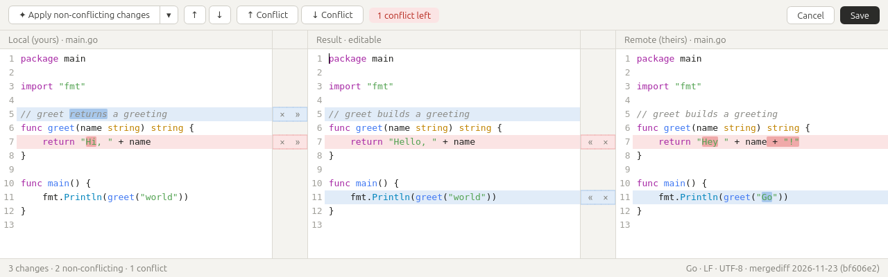

# mergediff

A lightweight, cross-platform **3-way merge** and **2-way diff** tool with a
native window, inspired by the JetBrains merge tool. One small binary for
Windows, macOS and Linux that works as a Git `mergetool` and `difftool`,
including `git difftool -d`, and lists all of a merge's conflicts in one
window with `mergediff resolve` (see [Git integration](GIT.md)).

- Three panes, **Local | Result | Remote**, with an editable Result in the middle
- Non-conflicting changes applied in one click (and undone in one step)
- Per-change `»` / `«` apply and `×` ignore buttons; applying both sides of a
  conflict inserts both (local first)
- Line and word-level highlighting, connectors between matching changes,
  chunk-aligned scrolling
- Syntax highlighting by file extension; light and dark themes that follow the
  system or a setting
- A directory diff: every changed file of two directories (or of
  `git difftool -d`) in one list, each opening in its own diff window
- A Conflicts window for a merge, rebase, cherry-pick or revert that stopped
  with conflicts (`mergediff resolve`): every conflicted file with what each
  branch did to it, *Accept Yours* / *Accept Theirs* for several files at once,
  or *Merge…* one in the 3-way view
- A scratch mode for comparing pasted text (`mergediff` without arguments)
- Keeps the file's line endings (LF / CRLF) and trailing newline
- Handles files of 10,000+ lines without lag



More in [SCREENSHOT.md](SCREENSHOT.md): the dark theme, the Conflicts window
and the directory diff.

## Installation

### Download a release

Download the file for your platform from the
[Releases](https://github.com/hadi-susanto/mergediff/releases) page and make
`mergediff` available on your `PATH` (see the notes below):

| Platform                        | File                                                      |
|---------------------------------|-----------------------------------------------------------|
| Windows (x64)                   | `mergediff_<date>_windows_amd64.zip` (`mergediff.exe`)    |
| macOS (Apple silicon and Intel) | `mergediff_<date>_darwin_universal.zip` (`mergediff.app`) |
| Linux (x64)                     | `mergediff_<date>_linux_amd64.tar.gz` (`mergediff`)       |
| Debian / Ubuntu (x64)           | `mergediff_<date>_linux_amd64.deb`                        |

Check a download against `SHA256SUMS.txt` with `sha256sum -c --ignore-missing SHA256SUMS.txt`.

Platform notes:

- **Windows:** put `mergediff.exe` in a folder on your `PATH`. It needs the
  Microsoft Edge WebView2 runtime, which Windows 10 and 11 normally include.
- **macOS:** move `mergediff.app` to `/Applications` and link its binary
  onto your `PATH` for the command line and Git:
  `sudo ln -sf /Applications/mergediff.app/Contents/MacOS/mergediff /usr/local/bin/mergediff`.
  The app is not signed or notarized yet. If macOS blocks the first run,
  allow it under *System Settings → Privacy & Security* ("Open Anyway"), or
  run `xattr -dr com.apple.quarantine /Applications/mergediff.app`.
- **Linux:** put `mergediff` in a folder on your `PATH`. It needs GTK 4 and
  WebKitGTK 6.0 at runtime, e.g. on Ubuntu 24.04 or later:
  `sudo apt install libgtk-4-1 libwebkitgtk-6.0-4`.
- **Debian / Ubuntu:** `sudo apt install ./mergediff_<date>_linux_amd64.deb`
  installs the binary to `/usr/bin`, a desktop entry and icon, and pulls in the
  GTK 4 and WebKitGTK 6.0 runtime libraries (Ubuntu 24.04 or later).

### Build from source

Prerequisites: Go (latest stable), Node.js LTS with npm, the Wails v3 CLI at the
version in `go.mod`, and on macOS/Linux a C toolchain (Xcode command-line
tools; gcc + pkg-config). Linux also needs `libgtk-4-dev libwebkitgtk-6.0-dev`.

```sh
go install github.com/wailsapp/wails/v3/cmd/wails3@v3.1.0
git clone https://github.com/hadi-susanto/mergediff.git
cd mergediff
make deps     # Go modules, npm packages, wails3 doctor
make build    # → bin/mergediff (bin/mergediff.exe on Windows)
```

On macOS, `make build UNIVERSAL=1` builds one binary for arm64 and amd64, and
`wails3 task darwin:create:app:bundle` then wraps it in `bin/mergediff.app`
(as the release does).

## Usage

```
mergediff BASE LOCAL REMOTE -o MERGED [--auto-apply]    3-way merge
mergediff LEFT RIGHT                                    2-way diff (read-only)
mergediff LEFTDIR RIGHTDIR                              directory diff (git difftool -d)
mergediff resolve [--auto-apply] [--] [PATH...]         conflicts of a stopped merge, in this repository
mergediff                                               scratch diff of pasted text
mergediff settings [list | get KEY | set KEY VALUE | unset KEY | path]
mergediff --help | --version
```

Any window can also take `--theme system|light|dark` and
`--window-state normal|maximized` (see [Settings](#settings)).

- **Merge:** the Result pane starts with the BASE text. Apply changes with the
  gutter buttons, or all non-conflicting ones with *✦ Apply non-conflicting
  changes* (its `▾` menu limits it to Local or Remote). `--auto-apply` applies
  them at startup. Conflicts always start as the base text, and you can edit
  the Result freely. `↑` / `↓` move between changes, *↑ Conflict* / *↓ Conflict* between conflicts. *Save* writes
  MERGED.
- **Diff:** two read-only panes with the differences highlighted.
- **Directory diff:** when both arguments are directories, one window lists
  the files that differ, sorted by path, with their status (**M**odified,
  **A**dded, **D**eleted, or **!** when a file cannot be read) and the lines
  added and removed. Double-click a file or press `Enter` to open it in a
  diff window of its own; added and deleted files open with the missing side
  empty. Filter by path, pick a status with the chips, *Show unchanged*
  files, or *Group by directory*. Binary files, invalid UTF-8 and files over
  5 MB are listed but cannot be opened. Large directories show a
  "Comparing…" count while they are read. Closing the list closes the files
  opened from it. A directory and a file together are a usage error.
- **Resolve:** run inside a Git working tree stopped by conflicts (a merge,
  rebase, cherry-pick, revert or `git stash pop`). The window names the
  operation ("Merging origin/main into feature/checkout") and lists every
  conflicted file, or those under `PATH...`, with what *Yours* and *Theirs*
  (labelled with the branch names) did to it. Select files (`Ctrl`/`Shift`+click
  for several) and:
  - **Merge…** (double-click or `Enter`): opens the file in the 3-way merge
    view in a window of its own, with base / yours / theirs from Git.
    *Save* writes the file and `git add`s it. `--auto-apply` applies to these
    windows. While it is open the file cannot be accepted.
  - **Accept Yours / Accept Theirs**: takes that side's whole file
    (`git checkout --ours|--theirs` and `git add`, or `git rm` when that side
    deleted it). Several files ask first. For a modify/delete conflict the
    buttons say what they do ("Keep modified (yours)", "Delete (theirs)") and
    *Show changes* compares the original with the side that kept the file.
  - Binary files, symlinks and files that are not valid UTF-8 can only be
    accepted; submodules are left to Git.

  While rebasing, *Yours* is your commit being replayed and *Theirs* is the
  branch you rebase onto (Git's "ours" and "theirs" are the other way round).
  A file you edited by hand since Git stopped is flagged, and accepting or
  saving over it asks first. Files resolved meanwhile in a terminal show as
  resolved after `F5`. When none are left, a banner shows the command that
  finishes the operation (e.g. `git merge --continue`) with a *Copy* button;
  mergediff never runs it, nor any Git command other than `checkout --ours /
  --theirs`, `add` and `rm` on the conflicted files. It needs `git` 2.11 or
  later on the `PATH`.
- **Scratch:** started without arguments, mergediff opens two empty, editable
  panes. Paste or type text into both and press *⟳ Refresh* (`F5` or
  `Ctrl+Enter`) to compare them. After an edit the highlights are cleared
  until the next refresh.

Files must be UTF-8 text; binary files and invalid UTF-8 are rejected (in
`mergediff resolve` they can still be accepted whole). A missing BASE (Git's
add/add conflicts) is treated as empty.

Exit codes:

| Code | Meaning                                                                                                                  |
|------|--------------------------------------------------------------------------------------------------------------------------|
| `0`  | merge saved with all conflicts resolved, the diff, directory or scratch window closed, or a `settings` command succeeded |
|      | `resolve`: no conflicts left within its paths when the window closed, or none to begin with ("no conflicts to resolve")  |
| `1`  | cancelled, or closed with unresolved conflicts or unsaved changes                                                        |
|      | `resolve`: closed with conflicts left                                                                                    |
| `2`  | usage, I/O or config file error (message on stderr); `resolve` outside a Git working tree, or Git missing or too old     |

Keyboard shortcuts (Cmd instead of Ctrl on macOS):

| Keys                | Action                                                                            |
|---------------------|-----------------------------------------------------------------------------------|
| `Ctrl+S`            | save                                                                              |
| `F7` / `Shift+F7`   | next / previous change                                                            |
| `Ctrl+Shift+A`      | apply all non-conflicting changes                                                 |
| `Ctrl+Z`            | undo (an "apply all" is one step)                                                 |
| `Esc`               | cancel (asks first if the result was edited); closes a diff, not a scratch window |
| `F5` / `Ctrl+Enter` | refresh the comparison (scratch mode)                                             |

In the directory diff:

| Keys                      | Action                                                         |
|---------------------------|----------------------------------------------------------------|
| `↑` / `↓`, `Home` / `End` | move the selection                                             |
| `Enter` or double-click   | open the selected file (on a directory header: fold / unfold)  |
| `←` / `→`                 | fold / unfold a directory (Group by directory)                 |
| `F7` / `Shift+F7`         | open the next / previous file                                  |
| `Ctrl+F`                  | filter by path                                                 |
| `Esc`                     | clear the filter; with an empty filter, close the window       |

In the Conflicts window (`mergediff resolve`):

| Keys                      | Action                                                         |
|---------------------------|----------------------------------------------------------------|
| `Enter` or double-click   | merge the selected file in a window of its own                 |
| `Ctrl+Shift+Y`            | accept yours for the selected files                            |
| `Ctrl+Shift+T`            | accept theirs for the selected files                           |
| `Ctrl`/`Shift`+click      | select several files                                           |
| `F5`                      | re-read the conflicts from Git                                 |
| `Ctrl+F`                  | filter by path                                                 |
| `Esc`                     | clear the filter; with an empty filter, close the window       |

## Settings

Settings live in a TOML file. Run `mergediff settings path` to find it:

| OS      | Config file                                                                     |
|---------|---------------------------------------------------------------------------------|
| Linux   | `~/.config/mergediff/config.toml` (or `$XDG_CONFIG_HOME/mergediff/config.toml`) |
| macOS   | `~/Library/Application Support/mergediff/config.toml`                           |
| Windows | `%AppData%\mergediff\config.toml`                                               |

| Key            | Values                    | Default  | Meaning                                                  |
|----------------|---------------------------|----------|----------------------------------------------------------|
| `theme`        | `system`, `light`, `dark` | `system` | colour theme; `system` follows the OS light/dark setting |
| `window-state` | `normal`, `maximized`     | `normal` | window state at startup                                  |

```toml
# ~/.config/mergediff/config.toml
theme = "dark"
window-state = "maximized"
```

Edit the file by hand, or from the command line. Comments and other lines
are kept:

```sh
mergediff settings                       # list: value, where it comes from, allowed values
mergediff settings set theme dark
mergediff settings get theme
mergediff settings unset theme           # back to the default
```

A command-line flag overrides the file for one run, e.g.
`mergediff --theme light a.txt b.txt`. A file with an unknown key or an
invalid value is an error (exit `2`, naming the file), so typos don't go
unnoticed. On Linux the window's title bar keeps the system theme; the
content follows the setting.

To compare a file literally named `settings`, write `./settings`.

## Git integration

Set mergediff up as Git's merge and diff tool:

```sh
git config --global merge.tool mergediff
git config --global mergetool.mergediff.cmd 'mergediff "$BASE" "$LOCAL" "$REMOTE" -o "$MERGED"'
git config --global mergetool.mergediff.trustExitCode true
git config --global diff.tool mergediff
git config --global difftool.mergediff.cmd 'mergediff "$LOCAL" "$REMOTE"'
```

Then `git mergetool` resolves conflicts, `git difftool` shows changes file
by file and `git difftool -d` shows them all in one directory diff.
`mergediff resolve` needs no configuration; to run it as `git resolve`:

```sh
git config --global alias.resolve '!f() { cd "${GIT_PREFIX:-.}" && mergediff resolve "$@"; }; f'
```

[GIT.md](GIT.md) explains each of them, the exit codes Git sees, useful
options and troubleshooting.

## Development

```
make help              # list targets
make dev               # run with hot reload on testdata/dev (ARGS="..." for other files,
                       #   e.g. ARGS="testdata/dev/dirdiff/left testdata/dev/dirdiff/right")
make dev-resolve       # the Conflicts window on a freshly conflicted sample repository
make build             # production binary in bin/
make check             # go vet, gofmt check, type-check, Go and frontend tests
make test              # clean, check (uncached), then end-to-end tests
make e2e               # build, then end-to-end UI tests only (Linux/X11)
make version           # version string a build would embed
make clean             # remove build output and Wails' task cache
```

- Go code lives in `internal/` (`config`, `textio`, `diff`, `merge`, `dirdiff`,
  `gitconflict`, `session`); the root package only wires the CLI and Wails together.
- The frontend (`frontend/src`) is vanilla TypeScript with CodeMirror 6. Logic
  modules are DOM-free and tested with `node --test`.
- End-to-end tests (`make e2e`, Linux/X11) drive the real window with
  `git mergetool`, `git difftool -d` and `mergediff resolve`; see
  [scripts/e2e/README.md](scripts/e2e/README.md).

### Versions

Versions are dates with the commit: `mergediff --version` prints e.g.
`mergediff 2026-11-19 (a1b2c3d)`. Local builds use today's UTC date and add
`-dirty` when the working tree has uncommitted or untracked files. Builds
without the Makefile (`go run .`) report `dev (unknown)`.

## Releasing

Releases are tagged `vYYYY-MM-DD`, at most one per day. From an up-to-date
`main`:

```sh
make release-dry-run   # checks only: shows what would be tagged
make release           # tags today's date and pushes the tag (YES=1 skips the prompt)
```

`make release` stops at the first failed check: the branch must be `main`,
the working tree clean (untracked files count), `main` equal to
`origin/main`, today's tag unused locally and on `origin`, and `make check`
green. It never moves an existing tag.

Pushing the tag starts the [release workflow](.github/workflows/release.yml)
([Actions](https://github.com/hadi-susanto/mergediff/actions)): it runs the
tests, builds Windows, macOS (universal, as `mergediff.app`) and Linux
binaries plus a Debian package, and publishes a GitHub Release named
`mergediff YYYY-MM-DD (commit)` with the archives, the `.deb`,
`SHA256SUMS.txt` and the commits since the previous release.

## License

[MIT](LICENSE)
