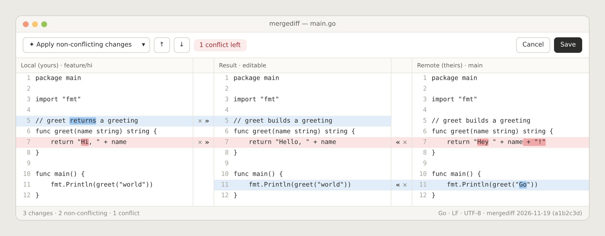
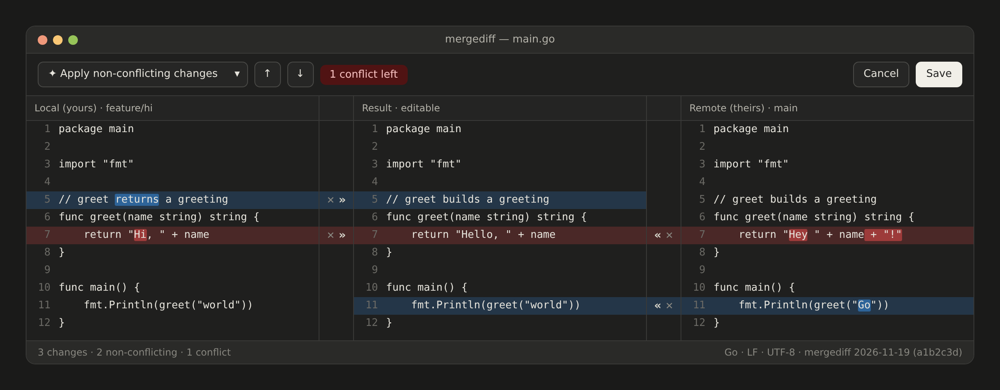

# mergediff

A lightweight, cross-platform **3-way merge** and **2-way diff** tool with a
native window, inspired by the JetBrains merge tool. One small binary for
Windows, macOS and Linux that works as a Git `mergetool` and `difftool`.

- Three panes, **Local | Result | Remote**, with an editable Result in the middle
- Non-conflicting changes applied in one click (and undone in one step)
- Per-change `»` / `«` apply and `×` ignore buttons; applying both sides of a
  conflict inserts both (local first)
- Line and word-level highlighting, connectors between matching changes,
  chunk-aligned scrolling
- Syntax highlighting by file extension, light and dark themes following the system
- Keeps the file's line endings (LF / CRLF) and trailing newline
- Handles files of 10,000+ lines without lag

## Screenshots

Real screenshots will follow; until then, the design mockups:




## Installation

### Download a release

Download the archive for your platform from the
[Releases](https://github.com/hadi-susanto/mergediff/releases) page and put
the binary on your `PATH`:

| Platform | Archive |
|---|---|
| Windows (x64) | `mergediff_<date>_windows_amd64.zip` |
| macOS (Apple silicon and Intel) | `mergediff_<date>_darwin_universal.zip` |
| Linux (x64) | `mergediff_<date>_linux_amd64.tar.gz` |

Check a download against `SHA256SUMS.txt` with `sha256sum -c --ignore-missing SHA256SUMS.txt`.

Platform notes:

- **macOS:** binaries are not signed or notarized yet. If macOS blocks the
  first run, allow it under *System Settings → Privacy & Security* ("Open
  Anyway"), or run `xattr -d com.apple.quarantine /path/to/mergediff`.
- **Linux:** needs GTK 4 and WebKitGTK 6.0 at runtime, e.g. on Ubuntu 24.04 or later:
  `sudo apt install libgtk-4-1 libwebkitgtk-6.0-4`.
- **Windows:** needs the Microsoft Edge WebView2 runtime, which Windows 10
  and 11 normally include.

### Build from source

Prerequisites: Go (latest stable), Node.js LTS with npm, the Wails v3 CLI at the
version in `go.mod`, and on macOS/Linux a C toolchain (Xcode command-line
tools; gcc + pkg-config). Linux also needs `libgtk-4-dev libwebkitgtk-6.0-dev`.

```sh
go install github.com/wailsapp/wails/v3/cmd/wails3@v3.1.0
git clone https://github.com/hadi-susanto/mergediff.git
cd mergediff
make deps     # Go modules, npm packages, wails3 doctor
make build    # → bin/mergediff (bin/mergediff.exe on Windows)
```

On macOS, `make build UNIVERSAL=1` builds one binary for arm64 and amd64.

## Usage

```
mergediff BASE LOCAL REMOTE -o MERGED [--auto-apply]   3-way merge
mergediff LEFT RIGHT                                    2-way diff (read-only)
mergediff --help | --version
```

- **Merge:** the Result pane starts with the BASE text. Apply changes with the
  gutter buttons, or all non-conflicting ones with *✦ Apply non-conflicting
  changes* (its `▾` menu limits it to Local or Remote). `--auto-apply` applies
  them at startup. Conflicts always start as the base text, and you can edit
  the Result freely. *Save* writes MERGED.
- **Diff:** two read-only panes with the differences highlighted.

Files must be UTF-8 text; binary files and invalid UTF-8 are rejected. A
missing BASE (Git's add/add conflicts) is treated as empty.

Exit codes:

| Code | Meaning |
|---|---|
| `0` | merge saved with all conflicts resolved, or the diff window closed |
| `1` | cancelled, or closed with unresolved conflicts or unsaved changes |
| `2` | usage or I/O error (message on stderr) |

Keyboard shortcuts (Cmd instead of Ctrl on macOS):

| Keys | Action |
|---|---|
| `Ctrl+S` | save |
| `F7` / `Shift+F7` | next / previous change |
| `Ctrl+Shift+A` | apply all non-conflicting changes |
| `Ctrl+Z` | undo (an "apply all" is one step) |
| `Esc` | cancel (asks first if the result was edited) |

## Git configuration

```sh
git config --global merge.tool mergediff
git config --global mergetool.mergediff.cmd 'mergediff "$BASE" "$LOCAL" "$REMOTE" -o "$MERGED"'
git config --global mergetool.mergediff.trustExitCode true
git config --global diff.tool mergediff
git config --global difftool.mergediff.cmd 'mergediff "$LOCAL" "$REMOTE"'
```

Then use `git mergetool` during a conflicted merge, rebase or cherry-pick,
and `git difftool` to view changes. With `trustExitCode`, Git marks a file
resolved only when mergediff saved it with no conflicts left (exit `0`).
Add `--auto-apply` to the mergetool command to start with the
non-conflicting changes already applied.

## Development

```
make help              # list targets
make dev               # run with hot reload on testdata/dev (ARGS="..." for other files)
make build             # production binary in bin/
make check             # go vet, gofmt check, type-check, Go and frontend tests
make test              # clean, check (uncached), then end-to-end tests
make version           # version string a build would embed
make clean             # remove build output and Wails' task cache
```

- Go code lives in `internal/` (`textio`, `diff`, `merge`, `session`); the
  root package only wires the CLI and Wails together.
- The frontend (`frontend/src`) is vanilla TypeScript with CodeMirror 6. Logic
  modules are DOM-free and tested with `node --test`.
- End-to-end tests (`make e2e`, Linux/X11) drive the real window with
  `git mergetool`; see [scripts/e2e/README.md](scripts/e2e/README.md).

### Versions

Versions are dates with the commit: `mergediff --version` prints e.g.
`mergediff 2026-11-19 (a1b2c3d)`. Local builds use today's UTC date and add
`-dirty` when the working tree has uncommitted or untracked files. Builds
without the Makefile (`go run .`) report `dev (unknown)`.

## Releasing

Releases are tagged `vYYYY-MM-DD`, at most one per day. From an up-to-date
`main`:

```sh
make release-dry-run   # checks only: shows what would be tagged
make release           # tags today's date and pushes the tag (YES=1 skips the prompt)
```

`make release` stops at the first failed check: the branch must be `main`,
the working tree clean (untracked files count), `main` equal to
`origin/main`, today's tag unused locally and on `origin`, and `make check`
green. It never moves an existing tag.

Pushing the tag starts the [release workflow](.github/workflows/release.yml)
([Actions](https://github.com/hadi-susanto/mergediff/actions)): it runs the
tests, builds Windows, macOS (universal) and Linux binaries, and publishes a
GitHub Release named `mergediff YYYY-MM-DD (commit)` with the archives,
`SHA256SUMS.txt` and the commits since the previous release.

## License

[MIT](LICENSE)
