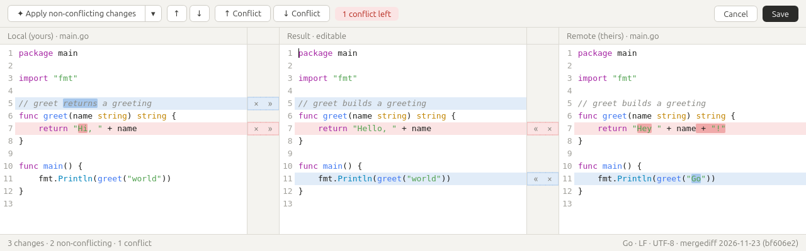
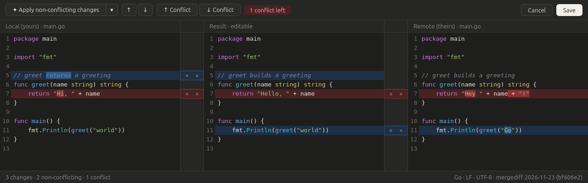
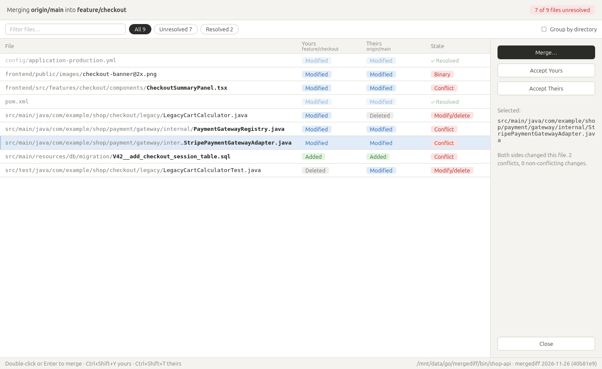
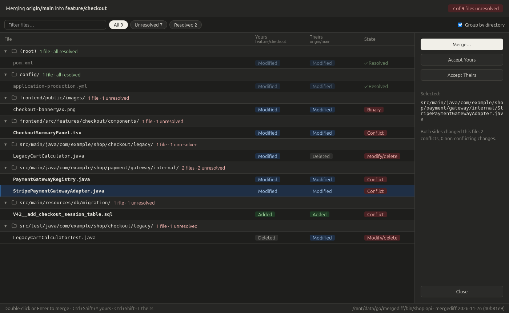
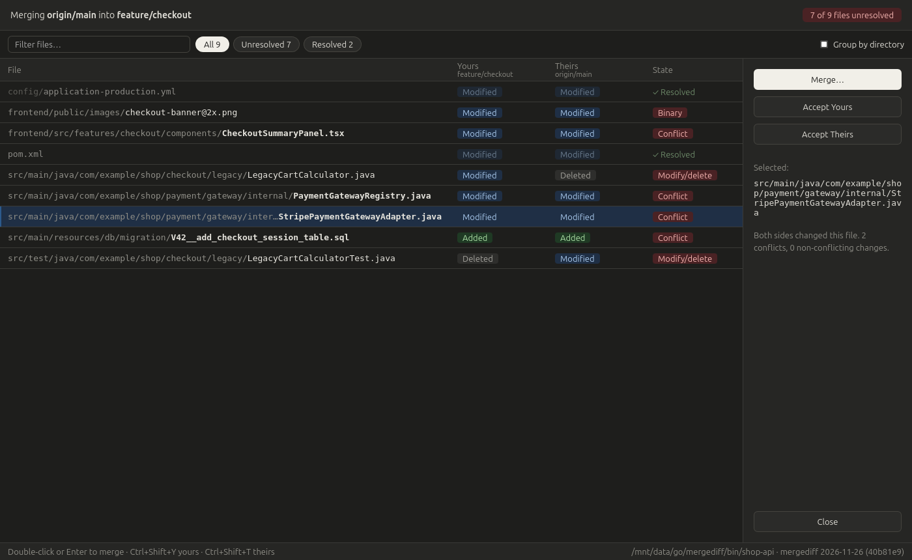
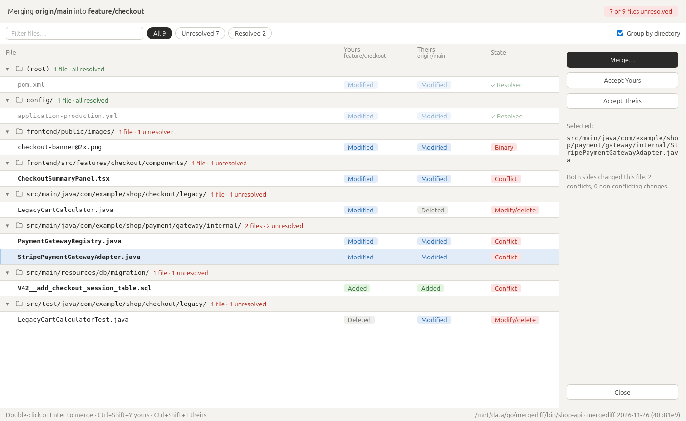
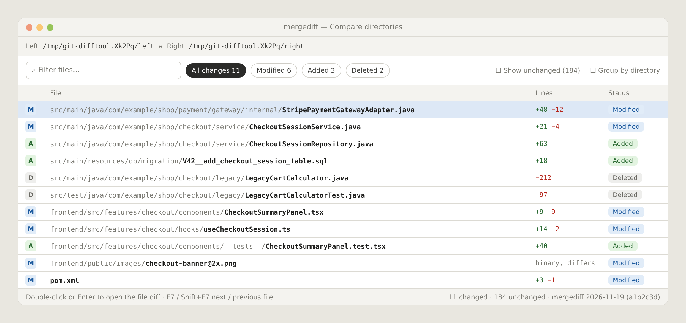
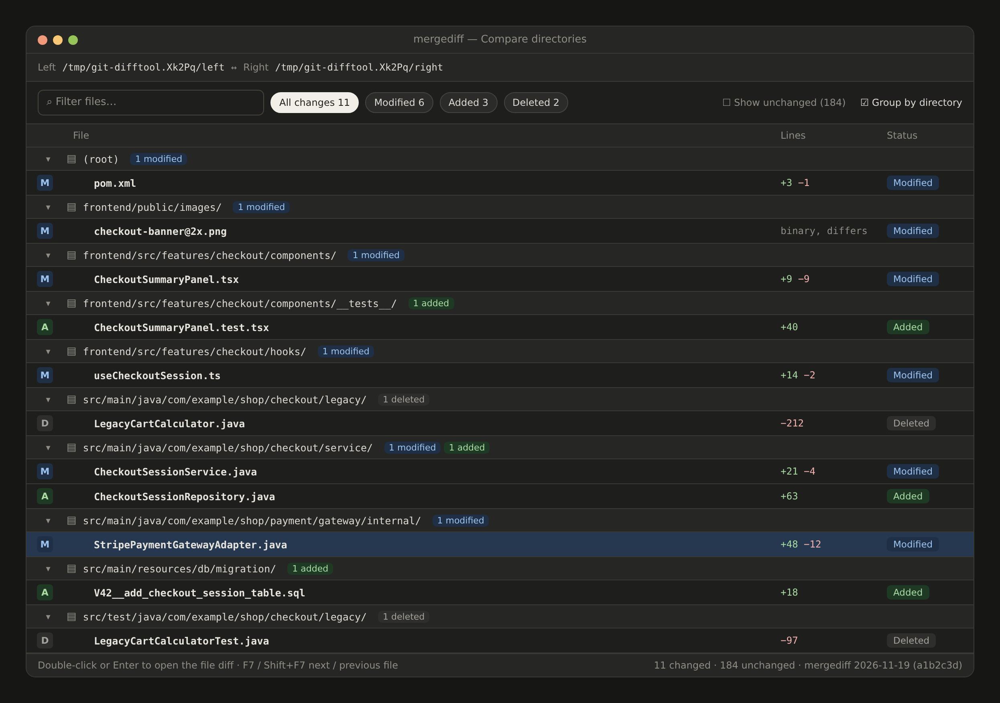

# Screenshots

Back to the [README](README.md).

## 3-way merge

A merge with one conflict, in the light and dark themes:

## Conflicts window (`mergediff resolve`)

A merge of `origin/main` into `feature/checkout` stopped with nine
conflicts (the sample repository from `scripts/dev/conflict-repo.sh`), two of
them already resolved in the window. The list in the light theme:

Grouped by directory, in the dark theme:

The same two views in the other theme:

## Directory diff

Design mockups, until real screenshots are added. The flat list and the list
grouped by directory:

